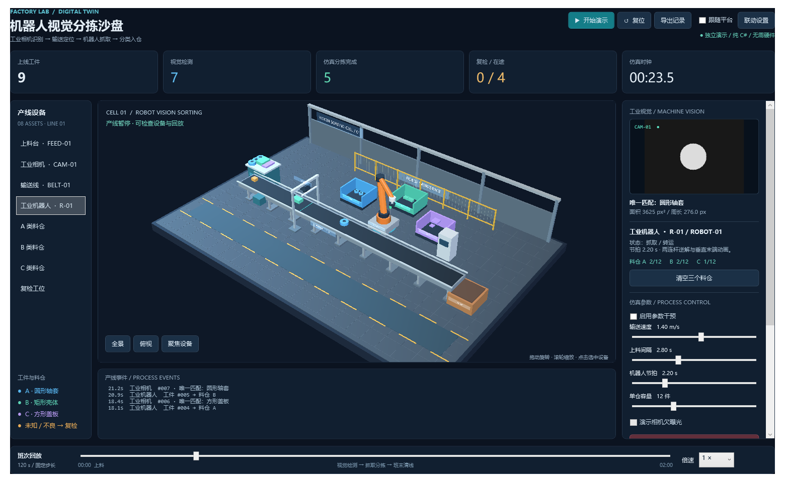

# 机器人视觉分拣三维数字孪生沙盘

独立 C# / WPF / .NET 10 桌面程序，参考 [mrf-shiftlab](https://github.com/agentthink/mrf-shiftlab) 的三维沙盘、设备选择、参数干预和时间轴交互思路，针对工业相机识别与工业机器人产品分拣重新实现。

不引用原平台项目，不依赖 OpenCV、浏览器、WebView、第三方三维库、外部模型或在线资源。所有厂房与设备几何由 C# 创建。原平台和沙盘分别编译、分别运行，通过公开的本机消息协议联动。



## 运行

使用 Visual Studio 打开 `RobotVisionSortingTwin.sln`，将沙盘设为启动项目，按 F5。

命令行：

```powershell
dotnet run --project RobotVisionSortingTwin.csproj -c Release
```

编译后的入口：

```text
bin\Release\net10.0-windows\RobotVisionSortingTwin.exe
```

文件夹发布：

```powershell
dotnet publish RobotVisionSortingTwin.csproj -c Release --self-contained false -o artifacts/app
```

发布文件夹需整体复制，目标电脑需要 .NET 10 Desktop Runtime x64。需要包含运行时的发布包时，可使用 `-r win-x64 --self-contained true`，首次需要还原对应运行时包。

## 独立演示

点击“开始演示”，观察上料、输送、相机检测、机械臂抓取、分类入仓与不合格工件复检。默认班次 120 秒，86 秒后停止上料，默认参数下剩余工件自然处理完毕。结束后保留现场，重新开始或复位可运行下一班。

- 鼠标拖动旋转，滚轮缩放。点击设备或左侧设备列表查看详情，“聚焦设备”进入近景。
- 暂停、1/2/4 倍速、时间轴拖动。时间轴通过固定步长重算，包含参数干预的历史也可重现。
- 勾选“启用参数干预”，可调输送速度、上料间隔、机器人节拍与单仓容量。改变机器人节拍从下一件抓取生效。
- “演示相机欠曝光”会降低合成图像的目标亮度，改变实际像素分割结果，无法识别的工件转入复检。
- 料仓满后阻止输送；“清空三个料仓”后继续，累计分拣数不清零。
- 仿真急停冻结输送与机械臂；恢复后从原位置继续。暂停时的操作记录在下一仿真步生效。
- “导出记录”保存指标、料仓映射、干预日志和最近 100 条产线事件。

演示视觉是纯 C# 的合成帧阈值分割、四邻域连通域、面积和像素边界周长测量，再与三种参考模板唯一匹配，不按输入类别直接给出识别结果。这里的像素边界周长与原平台 OpenCV 的轮廓弧长定义不同，不能相互比较参考数值。

## 两个程序联动

配套平台位于 `D:\WorkSpace\Codex\DigitalTwinIndustrialAutomationPlatform.NativeWpf`。平台只新增可关闭的遥测发布器及菜单入口；原有产品配方、相机采集和机器人 TCP 协议继续由平台负责。两个工程没有 ProjectReference 或程序集引用关系。

1. 重新编译并运行原平台。在“识别与分拣系统 → 产品与机器人”菜单中，保持“同步到独立三维沙盘”勾选。
2. 独立启动沙盘，点击顶部“联动设置”。平台连接后，右侧会收到当前产品目录。
3. 分别为 A、B、C 料仓选择真实产品。按产品 GUID 匹配，不依赖产品名称或列表顺序；未映射产品和重复映射产品进入复检。
4. 勾选沙盘顶部“跟随平台”。此时关闭演示上料，等待平台采样。
5. 在原平台按既有流程连接相机、加载产品、连接机器人、开启自动识别。沙盘自动推进仿真，并显示相同识别样本的缩略图、面积、周长及分拣去向。
6. 平台停止自动识别后，沙盘暂停；平台重启识别会话后，沙盘清空上一会话的统计与现场，开始新会话。

两程序启动顺序不限。原平台周期性重连和发送状态，沙盘退出或繁忙不会阻塞原识别回调。关闭发布开关后平台不再尝试连接沙盘。

**联动的含义：**沙盘接收识别结果并生成动画。平台现有协议只报告产品类型写入 TCP，不含机器人执行 ACK、关节反馈、工件坐标或真实输送带编码器，因此沙盘的工件位置、抓取轨迹和“仿真分拣完成”不是现场执行确认。画面会标出 TCP 写入与未确认执行的区别。

一次采样生成一件展示工件。若同一实物停留在相机下，平台重复采样时沙盘也会重复展示；该消息协议没有实体工件追踪标识。动画队列最多 64 件，超过容量时继续显示最新识别结果并累计“动画队列溢出”，不会声称全部样本都已完成仿真分拣。接受的工件满足“上线 = 分拣 + 复检 + 在途”，在途包括尚未进入输送带的待展示队列。

联动模式锁定 1 倍速，关闭时间轴回放。断线或超过 4 秒无消息自动暂停，恢复后接收新采样，不回放断线积压。样本序号缺口和重复消息有独立计数。映射保存在当前沙盘会话中，重启沙盘后需重新指定。

## 结构

```text
App.xaml / MainWindow.xaml       独立窗口、操作面板、视觉预览和联动设置
Simulation/SortingSimulation.cs  固定步长、工件状态机、排队、联锁和干预回放
Simulation/DemoVisionService.cs  纯 C# 像素识别演示
Simulation/TwinScene.cs          WPF Viewport3D、程序化设备、自由相机与机械臂逆解
Simulation/TwinModels.cs         沙盘数据模型
Interop/TelemetryServer.cs      本机 NDJSON 协议接收端
docs/INTEROP.md                  对外消息格式和语义
tests/                          无额外测试框架依赖的验证程序
```

机械臂采用工业外观、两段固定臂长逆解及垂直末端抓取轨迹，未实现厂商六轴逆解、碰撞检测、动力学或机器人控制程序。真实工业相机的驱动适配及实际识别继续由现有平台负责；本次未连接实体相机或机器人。

## 验证

```powershell
dotnet run --project tests/Verify.csproj -c Release
dotnet run --project tests/Verify.csproj -c Release -- --render artifacts/verification
```

覆盖像素识别、欠曝光、逐步物料守恒、工件间距、默认班次清线、回放一致性、历史干预分支、料仓联锁、急停恢复、机械臂臂长、外部队列边界及命名管道的分包、粘包与重连。界面验证输出 1560 与 1100 两档宽度的 PNG。原平台另有发布器启停、JPEG 编码、断线重连和离线非阻塞验证。

可选的跨进程验证：编译原平台的 `tests/Verify.csproj` 后，在沙盘目录执行以下命令。测试会启动原平台的合成遥测发送器，向沙盘接收端传输产品目录、三帧采样、JPEG 预览及停止状态，不连接实体设备。

```powershell
dotnet run --project tests/Verify.csproj -c Release -- --platform-sender D:/WorkSpace/Codex/DigitalTwinIndustrialAutomationPlatform.NativeWpf/tests/bin/Release/net10.0-windows/win-x64/DigitalTwin.NativeWpf.Verify.exe
```

本机管道验证应在正常 Windows 环境运行；限制命名管道或 TCP 回环访问的执行环境可能拒绝相关测试。
